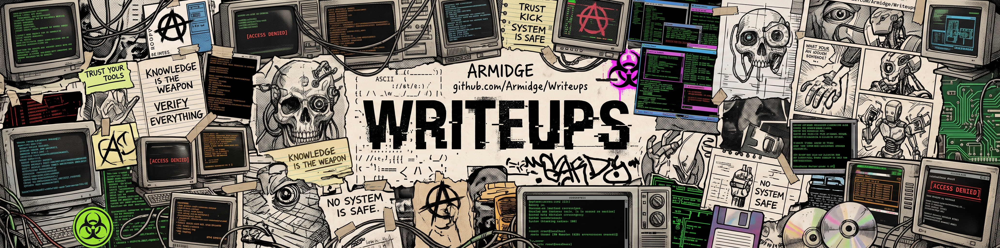

# Writeups

Registro técnico dos desafios de segurança da informação que resolvo em plataformas como TryHackMe e Hack The Box, com ênfase em documentar o raciocínio por trás de cada resolução: como a máquina ou sala foi abordada, quais ferramentas e técnicas foram usadas, por que funcionam e quais falhas de segurança expõem. O objetivo é consolidar o aprendizado, criando uma base de consulta para casos futuros e uma referência para estudantes e profissionais das mesmas áreas.

Os writeups seguem um formato padronizado ([`TEMPLATE.md`](TEMPLATE.md)), organizados por plataforma e por desafio. O conteúdo é educacional, com testes em ambientes autorizados, sem divulgação de flags, senhas ou tokens.

